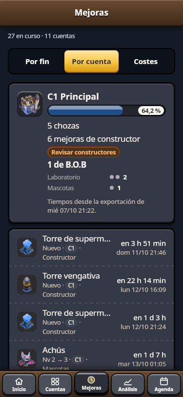
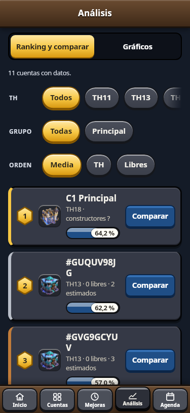
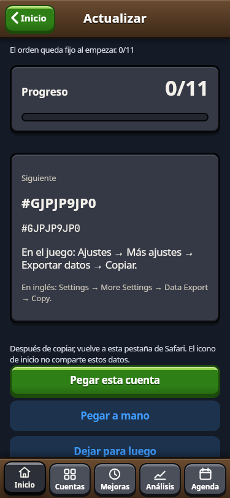
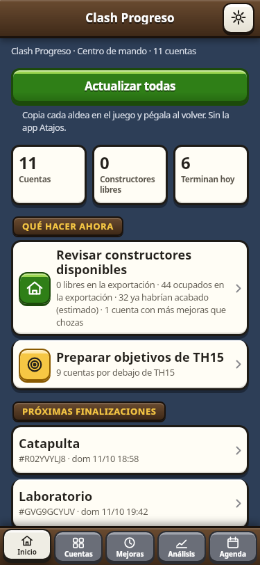
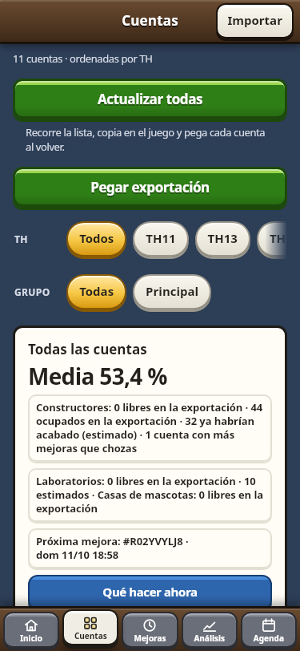
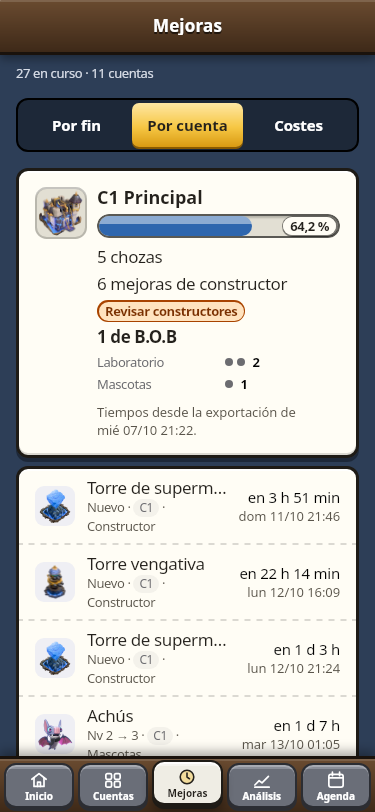
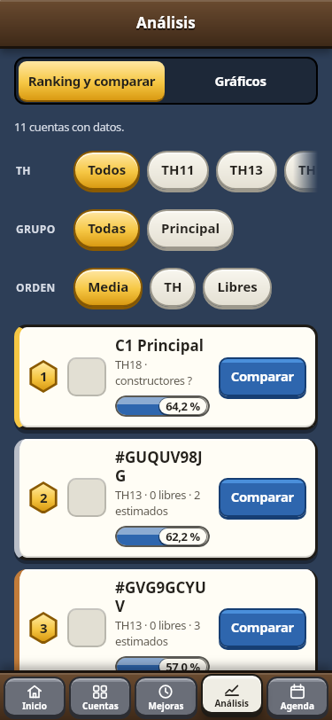
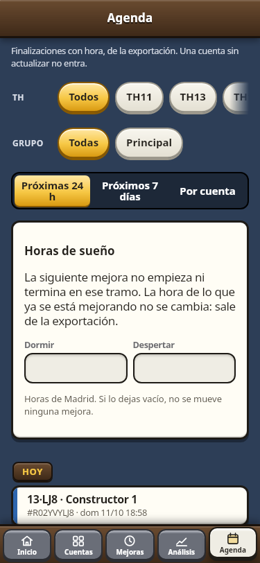

  

<h1 align="center">Clash Progreso</h1>

  <strong>Versión 3.1.14</strong> 
  El avance de varias aldeas de Clash of Clans, en el iPhone y sin cuenta. 
  <a href="https://ardu01.github.io/clash-progreso/">Abrir la app</a>

Clash Progreso guarda las exportaciones que pegas, calcula el avance hacia el máximo del ayuntamiento y lo compara entre cuentas. No hay login y no hay servidor. Las 11 aldeas que trae son de prueba: se pueden añadir, renombrar y borrar.

## Cómo instalarla en el iPhone

1. Abre [la app](https://ardu01.github.io/clash-progreso/) en **Safari**.
2. Toca **Compartir**.
3. Toca **Añadir a pantalla de inicio** y confirma.

A partir de ahí, ábrela desde el icono. Safari y el icono no comparten los datos: lo que importes en una pestaña de Safari no aparece en la app instalada. Impórtalo desde el icono.

La primera visita con red guarda la interfaz. Las imágenes se pueden descargar desde Copia para verlas sin conexión.

## Capturas

Datos de prueba del 7 de octubre de 2026.

| Inicio | Cuentas | Mejoras |
| --- | --- | --- |
|  |  |  |

| Análisis | Agenda | Actualizar todas |
| --- | --- | --- |
|  |  |  |

| Inicio en claro | Cuentas en claro | Mejoras en claro |
| --- | --- | --- |
|  |  |  |

| Análisis en claro | Agenda en claro |
| --- | --- |
|  |  |

## En esta versión

Inicio y Cuentas ocupan menos alto. Las cuentas dejan el nombre y el porcentaje con sitio, y Perfil y Editar siguen al lado. El resumen de constructores usa el ancho entero, así que no queda una loseta vacía al lado de la frase larga.

Cada paso dice de dónde sale: en la exportación, estimado, planificado, recomendado o provisional. Si la cuenta necesita actualización, Qué hacer ahora no la presenta como una cola libre: pide actualizar y conserva el plan.

Rushear a un ayuntamiento superior reparte el tiempo entre los constructores de esa cuenta. Si la exportación trae las chozas, se usa ese número, y la cabaña de B.O.B suma uno. Si no las trae, en la cuenta y en el plan se elige 4, 5 o 6. El fin es el de esas obras en paralelo. El plan también lista lo que hay que tener colocado para poder subir el ayuntamiento, con el nivel actual, el pedido, el coste y el tiempo. Esa lista es provisional.

## Funciones

La barra de abajo tiene cinco pestañas: **Inicio**, **Cuentas**, **Mejoras**, **Análisis** y **Agenda**. Copia y Acerca de, con el aviso de la Fan Content Policy, se abren con el botón de ajustes de Inicio.

### Inicio

El centro de mando de la flota.

- La cabecera y tres cifras: cuentas, constructores libres en la exportación y cuántas mejoras terminan hoy. Si no hay datos, un guion.
- **Qué hacer ahora**: revisar constructores disponibles y preparar objetivos de ayuntamiento.
- **Próximas finalizaciones**: las tres mejoras de la flota que acaban antes, con la cuenta y la hora. Si no hay ninguna, un guion.
- **Abrir hoy**: en qué orden abrir las cuentas, según el plan y la hora en que queda libre un constructor, el laboratorio o la casa de mascotas. Si el temporizador no es un número, esa cuenta no entra en el orden y no se inventa la hora.
- **Objetivos de flota**: las cuentas que comparten objetivo, cuántas ya están y una fecha estimada. Esa fecha es el fin del plan hasta el máximo del ayuntamiento anterior, no el día de subir el ayuntamiento. Si la cuenta no tiene un plan guardado para ese objetivo, el criterio es maxear.
- Tus cuentas, con la miniatura del ayuntamiento, en ese mismo orden. Al tocar una se abre su progreso.

### Cuentas

- La lista de las aldeas de prueba y de las que importes después. Se puede marcar una como Principal y ordenar por ayuntamiento, nombre o porcentaje.
- **Actualizar todas**, también en Inicio. Abre la lista en el orden de Abrir hoy. En el juego copias la aldea, vuelves y tocas **Pegar esta cuenta**: lee el portapapeles con ese toque. Si el iPhone no deja, hay un campo para pegar a mano. La app reconoce la cuenta por su etiqueta, la marca y la guarda al momento. Cada fila lleva la fecha de la última actualización. Completadas y pendientes se ven aparte. Al volver se sigue por la primera pendiente, sin repetir las hechas. Al cerrar la lista, el resumen cuenta cuentas, niveles nuevos, mejoras finalizadas y los cambios de constructores y de progreso que salgan del pegado. El progreso (por ejemplo 4 de 11) y la lista siguen si iOS cierra la app.
- **Pegar exportación** lee el portapapeles, detecta una o varias aldeas por la etiqueta y las añade o actualiza. Si no puede leerlo, se abre el campo de pegado. También se puede elegir el archivo guardado.
- Búsqueda por el nombre de la cuenta.
- Grupos opcionales, para filtrar en Cuentas, en Análisis y en la agenda.
- Una meta opcional, de una categoría o de la media, con su barra.
- Resumen de todas: media, constructores ocupados y libres, laboratorios y casas de mascotas libres, y la próxima mejora con hora.
- Aviso de cuentas que llevan tiempo sin datos. El plazo se cambia en Copia; al principio son más de 7 días.
- El equipamiento de cada cuenta va en su propia sección, debajo de las categorías de la aldea, con las piezas y las menas.

### Mejoras

Lo que está en curso en todas las cuentas, ordenado por cuándo termina, por cuenta o por el coste de llegar al máximo del ayuntamiento actual. Ese coste es oro, elixir, oscuro, otros recursos y días de constructor. Un muro de «oro o elixir» se paga con uno de los dos, no con los dos. No entra el coste de subir el ayuntamiento ni el de las menas.

### Análisis

Todas las cuentas visibles van en el mismo gráfico, cada una con un color fijo:

- Líneas del porcentaje medio.
- Barras por categoría, juntas o apiladas. En las apiladas cada color es el porcentaje de una categoría, no una suma de recursos.
- Mapa de calor de cuentas y categorías: por debajo del 50 %, del 50 al 79 %, del 80 al 99 % y al 100 %.
- Radar y ritmo semanal, de una cuenta.
- Niveles: evolución del ayuntamiento, héroes frente a su máximo, media por categoría, muros, laboratorio, mascotas, cara a cara y niveles por semana.

Cada punto es una exportación real. Con un solo día importado, la línea es un punto y el ritmo no muestra un cero inventado. El equipamiento no entra en estos gráficos.

El ranking ordena por la media, por el ayuntamiento o por los constructores libres, y permite comparar dos o tres cuentas.

### Agenda, plan y qué hacer ahora

- El plan es la línea de tiempo de la cuenta, también cuando no queda ningún constructor libre. Se elige maxear o rushear, y el ayuntamiento objetivo. Se pueden combinar ataque, defensa, muros, héroes, categoría, recurso y duración. El criterio se lee en viñetas.
- Si el objetivo es un ayuntamiento superior, el nivel pedido de la línea es el máximo del anterior. Rushear ordena almacenes, edificios de ejército y laboratorio hasta esos máximos, y reparte el tiempo entre los constructores de la cuenta. Aparte, el plan lista las estructuras que hay que tener para poder subir el ayuntamiento. Esa lista es provisional: los datos no traen la tabla del juego.
- Cada paso lleva coste, tiempo y fecha estimada en hora de Madrid, con los constructores de esa cuenta. Se pueden marcar las mejoras que se están haciendo o se van a hacer. La línea se recalcula al momento. Esas marcas no cambian niveles ni porcentajes.
- **Qué hacer ahora** enseña el siguiente paso de esa línea cuando un constructor, el laboratorio o la casa de mascotas están libres. Sin plan guardado, el criterio es maxear el ayuntamiento actual.
- La agenda tiene tres vistas: próximas 24 horas, próximos 7 días y por cuenta. Varias cuentas en la misma hora forman una sesión. Una cuenta sin actualizar no sale ahí solo porque un temporizador viejo haya llegado a cero.
- Los héroes de la cuenta de prueba no entran en el plan.
- El equipamiento no entra en el plan. Tiene su apartado: niveles por héroe, mena brillante, reluciente y estrellada, y el total de la flota.
- Horas de sueño opcionales, guardadas en el iPhone. La mejora en curso no se mueve. La siguiente no empieza ni acaba dentro de ese tramo.
- Si la exportación no trae los segundos que faltan, se avisa. No se inventa la hora.
- La agenda junta las horas reales de la exportación. Las marcas del plan no entran en la agenda ni en los avisos.

### Progreso, historial y avisos

- Porcentajes por categoría. La media es la de las categorías de la aldea. El equipamiento va aparte y no entra en esa media.
- Filtros de periodo (7 días, 30 días, 3 meses, todo o un rango), recurso, ayuntamiento y grupo. Valen en el progreso y en los gráficos.
- Historial de lo que subió entre importaciones, ritmo en niveles por semana y rachas: semanas seguidas mejorando, una categoría al máximo o el ayuntamiento completado.
- Aviso cuando termina una mejora, solo con la app abierta y si el iPhone permite notificaciones de la app instalada. Con la app cerrada no hay aviso: eso exigiría un servidor, y esta app no tiene.

### Copiar la aldea en el juego

El camino que muestra la app es:

**Ajustes → Más ajustes → Exportar datos → Copiar.**

El juego copia la aldea al portapapeles. No crea un archivo y no incluye el nombre del jugador. En Clash Progreso, en Cuentas, toca **Pegar exportación**, o usa **Pegar esta cuenta** dentro de Actualizar todas.

El menú en inglés, comprobado, es *Settings → More Settings → Data Export → Copy*. Los nombres en español de esos menús siguen sin confirmar; la app usa los de arriba hasta poder comprobarlos en el cliente.

Si el botón no puede leer el portapapeles, mantén pulsado el campo y elige Pegar, o elige el archivo en Archivos.

### Copia y aspecto

- Una copia con las cuentas, el historial, los planes, las marcas y la meta de cada cuenta. Al importar se guarda sola una copia en este iPhone. Si pasan 7 días sin otra, Copia lo avisa.
- Al restaurar se junta por etiqueta y por fecha: no borra lo que solo está en el iPhone, ni un plan o una marca que la copia no traiga.
- Tema del sistema, claro u oscuro.
- Descarga de imágenes para usarlas sin conexión.
- Restaurar los datos de prueba o borrar todos los datos, con confirmación.

## Privacidad

Las cuentas, el historial, los grupos, las metas, los planes, las marcas, los filtros, el tema y las horas de sueño se quedan en este iPhone. No hay cuenta, no hay login y no se envía nada a un servidor. Lo único que sale del teléfono es el archivo de copia, si lo guardas tú (Archivos, AirDrop u otra app del sistema).

Actualizar la app no borra las cuentas ni el historial. Una cuenta que hayas borrado no vuelve a aparecer sola.

## Aviso

This material is unofficial and is not endorsed by Supercell. For more information see Supercell's Fan Content Policy: [www.supercell.com/fan-content-policy](https://www.supercell.com/fan-content-policy).

Material no oficial, no respaldado por Supercell. Arte © Supercell bajo la Fan Content Policy. Las imágenes del Fan Kit se muestran sin modificar. Las no oficiales son una reducción (lado largo como máximo 512 px, sin recorte); imágenes no oficiales: ClashKing y Fandom (autores en el manifiesto). Esta app es gratuita, privada y sin fines comerciales.

[Leer la Fan Content Policy](https://supercell.com/en/fan-content-policy/)

## Detalles técnicos

La app es una página estática. No hay backend. Las cuentas y el historial viven en IndexedDB; la sesión de Actualizar todas, el tema, los filtros y el roster viven en localStorage. Safari y el icono de inicio no comparten ese almacén.

El roster sigue en la versión 2: una cuenta borrada no se vuelve a sembrar. La caché de la interfaz es `cp-shell-v33` y la de imágenes `cp-img-v9`. Los archivos de la interfaz llevan la versión en la dirección, para que una copia vieja no se mezcle con la nueva. Actualizar la interfaz no cambia los porcentajes de las 11 cuentas de prueba.

Los costes y los tiempos salen de `data/costes.json` (clash-of-clans-data 0.18.0, solo aldea principal). Los héroes de la cuenta de prueba `#28PLGP0G2` no entran en el plan. El recorrido de Actualizar todas, por si hace falta el detalle, está en `docs/atajo.md`. Cálculos, rutas e interfaz están en `docs/sistema.md`.

Los enlaces internos los abre el toque de la app. En el icono de inicio, un enlace de la página no cambia la vista por sí solo.

| Versión | Qué cambió |
| --- | --- |
| 3.1.14 | Rushear reparte el tiempo entre los constructores de la cuenta (los del JSON, o 4, 5 o 6 si no vienen). El plan lista los requisitos para subir el ayuntamiento y los marca como provisionales. |
| 3.1.13 | Inicio y Cuentas más compactos. Cada paso dice si es de la exportación, estimado, planificado, recomendado o provisional. Una cuenta sin actualizar no sale como cola libre. |
| 3.1.12 | El plan de cada cuenta se calcula una vez por pintado. Un guardado abortado no se da por hecho. Las cinco pestañas tienen captura en claro y en oscuro. |
| 3.1.11 | Inicio con las tres cifras de la flota, qué hacer ahora y las tres próximas finalizaciones. Actualizar todas sigue donde se quedó y cierra con un resumen de los datos pegados. La agenda separa 24 horas, 7 días y por cuenta, y agrupa la misma hora en una sesión. |
| 3.1.10 | Un fallo en un botón no deja la pantalla pillada. Inicio y Cuentas usan el mismo recuento de constructores: libre en la exportación, estimado si el temporizador ya llegó a cero, o «Necesita actualización» si la cuenta es vieja. El porcentaje de cada cuenta es frente al máximo de su ayuntamiento. |
| 3.1.9 | Inicio vuelve a abrirse desde las otras pestañas, también con Actualizar todas abierta. Qué hacer ahora, Abrir hoy, los objetivos y las tarjetas de cuenta los abre el toque. |
| 3.1.8 | Actualizar todas, dentro de la app: la lista sigue el orden de Abrir hoy, Pegar esta cuenta lee el portapapeles con el toque y, si falla, un campo. Cada cuenta se reconoce por la etiqueta, se marca y se guarda al momento. El progreso y la sesión siguen si iOS cierra la app. Ya no hace falta Atajos. |
| 3.1.7 | Imágenes no oficiales, marcadas como tales, solo donde el Fan Kit no tiene ese nivel. La herrería 10 sigue con la oficial del 9 y la bomba aérea 12 con la oficial del 11. El Crafting Station se llama Defensa artesanal. No entra la base del constructor. |
| 3.1.6 | Perfil de cada cuenta, desde Cuentas: nombre de la cuenta, etiqueta, ayuntamiento y los ajustes que trae la exportación. Los héroes se ven con el nivel y el máximo de ese ayuntamiento. Lo que la exportación no trae no se muestra y no se rellena a mano. |
| 3.1.5 | En Equipamiento, por cuenta y en el total de la flota: mena brillante, reluciente y estrellada para maxearlo todo, con filtros y el coste de cada nivel pendiente. |
| 3.1.4 | Imagen oficial de niveles que estaban prestados y de la torre de supermagos. Nombres del texto del juego: Escolta títere, Orbe oscuro, Copo de escarcha, Pistola aturdidora, Cabaña de B.O.B. y Cohetes de defensa. L.A.S.S.I. lleva el punto. |
| 3.1.3 | Flecha monolítica y Colmillos eléctricos con la tabla de mena de cada uno. Bomba aérea del ayuntamiento 18: 8. Costes y tiempos corregidos. Ninguna de las 11 cuentas cambia de porcentaje. |
| 3.1.2 | Inicio con el resumen, qué hacer ahora, el orden para abrir las cuentas hoy y los objetivos de flota. Cinco pestañas: Inicio, Cuentas, Mejoras, Análisis y Agenda. |
| 3.1.1 | Imagen oficial de los niveles que estaban prestados, más el Cuervo avaricioso. La Artillería infernal se ve en español. |
| 3.1.0 | Qué hacer ahora sale del plan de cada cuenta. Línea de tiempo con ayuntamiento objetivo y marcas. Equipamiento aparte de la media. |
| 3.0.0 | Varias cuentas en los mismos gráficos, pegado directo, flota, filtros, plan con agenda, coste hasta el máximo, ranking, historial con rachas y avisos con la app abierta. |
| 2.1.4 | Encuadre de los iconos en Safari e identificación de niveles y piezas. |
| 2.1.3 | Iconos con margen. La interfaz deja de mostrar «ID deducido». |
| 2.1.2 | Cada miniatura muestra el dibujo entero, sin recorte. |
| 2.1.1 | El aviso legal queda solo en Copia. |
| 2.1.0 | Imagen oficial del nivel de cada edificio. |
| 2.0.0 | Cuentas propias, cinco pestañas y copia que fusiona sin borrar. |
| 1.1.6 | Icono de la app en la pantalla de inicio. |
| 1.1.5 | Descarga parcial, alertas accesibles y etiquetas de equipamiento. |
| 1.1.4 | Auditoría de diseño y foco en las hojas. |
| 1.1.3 | Ajustes de Importar. |
| 1.1.2 | Ajustes de Importar y del recuento de piezas sin identificar. |
| 1.1.1 | Importar rediseñado y contador de imágenes. |
| 1.1.0 | Imágenes y máximo en cada fila. |
| 1.0 | Primera versión, con las 11 cuentas de prueba. |
