

  

<h1 align="center">Clash Progreso</h1>

  <strong>Versión 3.0.0</strong> 
  Seguimiento de varias cuentas de Clash of Clans, en el iPhone y sin servidor. 
  <a href="https://ardu01.github.io/clash-progreso/">Abrir la app</a>

Clash Progreso guarda las exportaciones que cada persona pega, calcula el avance hacia el máximo del ayuntamiento y lo compara entre cuentas. No hay login ni backend. Las 11 aldeas incluidas son datos de prueba: se pueden añadir, renombrar y borrar.

## Capturas

iPhone (393×852, escala 3), con las exportaciones del 7 de octubre de 2026.

| Cuentas | Progreso | Mejoras |
| --- | --- | --- |
| 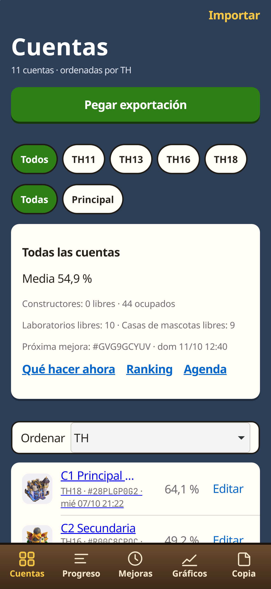 | 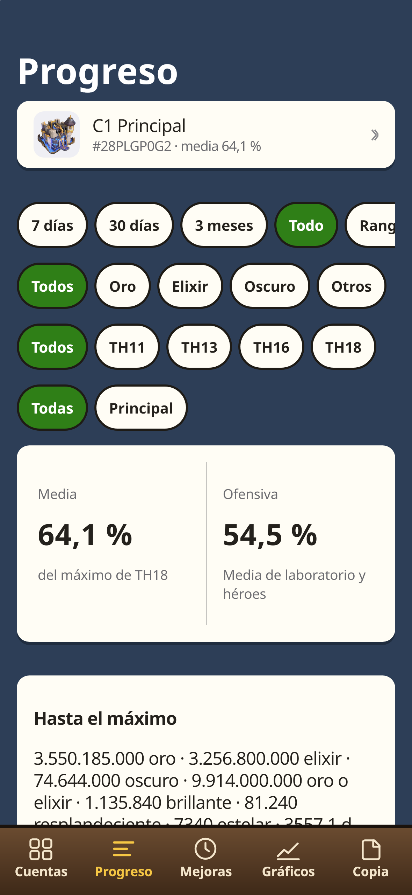 | 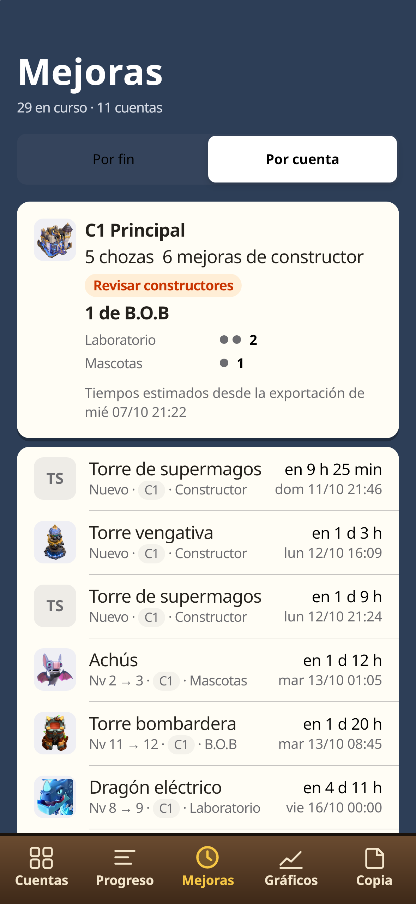 |

| Gráficos | Barras | Mapa de calor |
| --- | --- | --- |
| 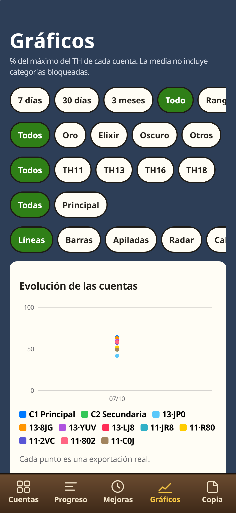 | 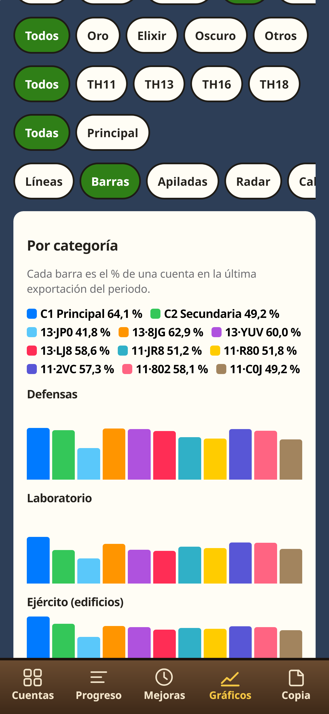 | 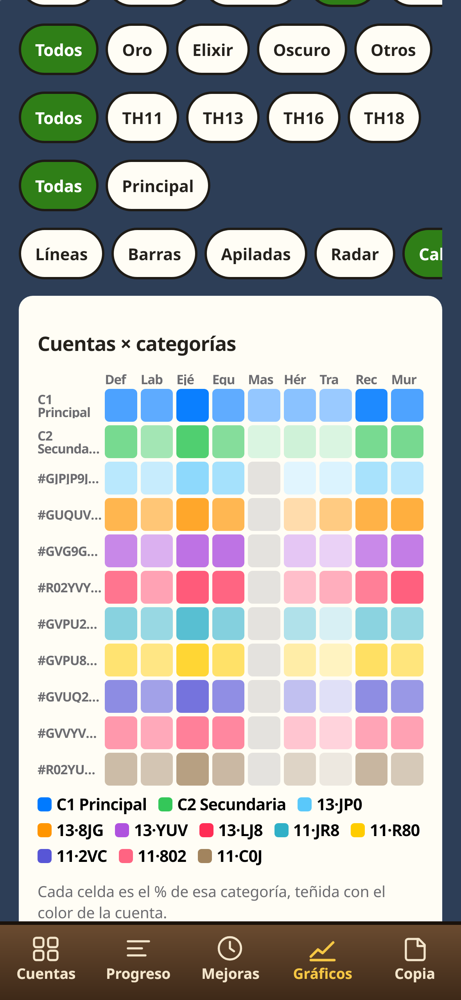 |

| Qué hacer ahora | Ranking | Agenda |
| --- | --- | --- |
| 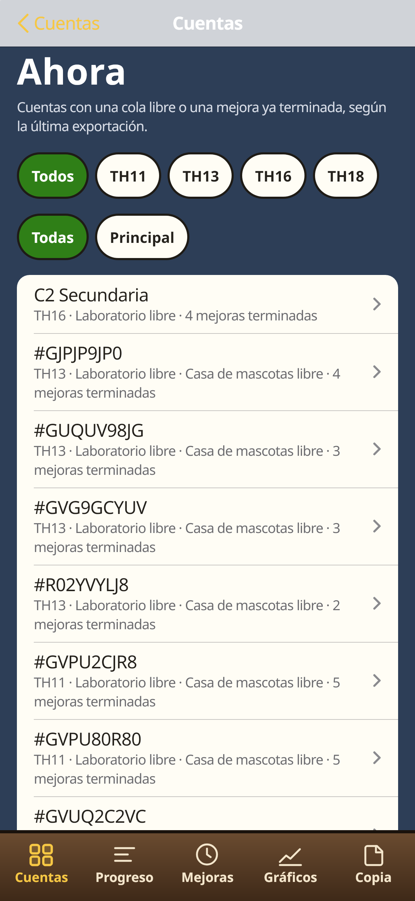 | 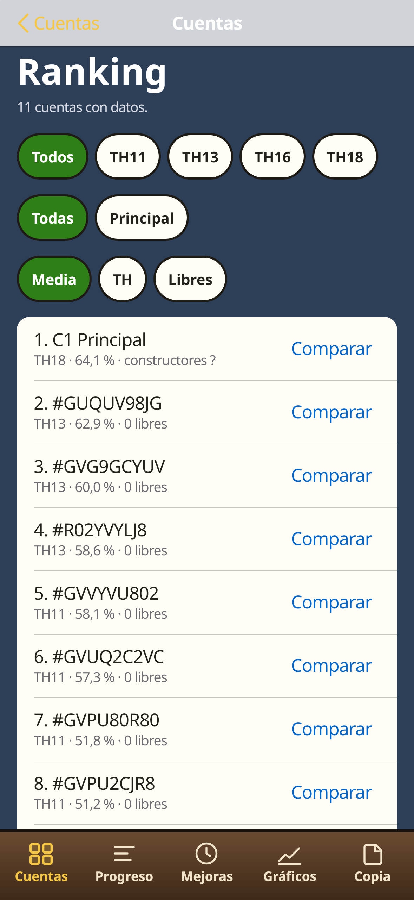 | 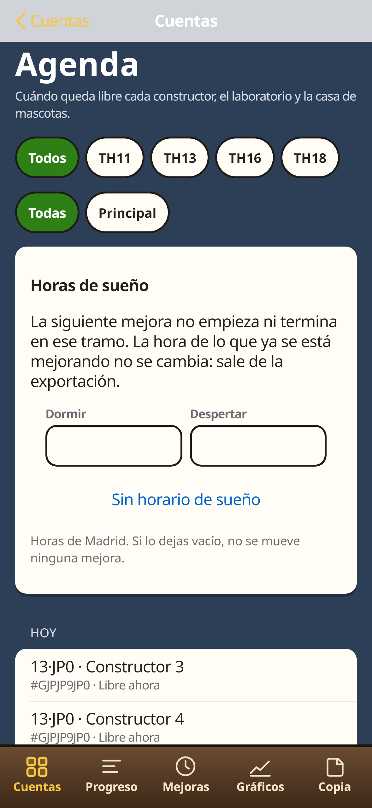 |

| Plan | Historial | Copia |
| --- | --- | --- |
| 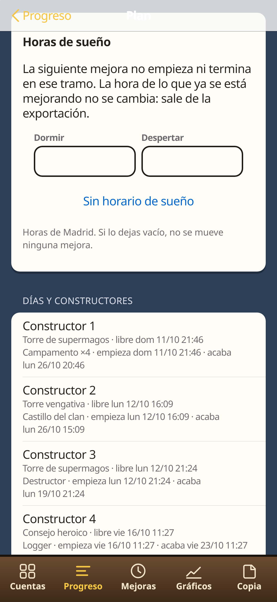 | 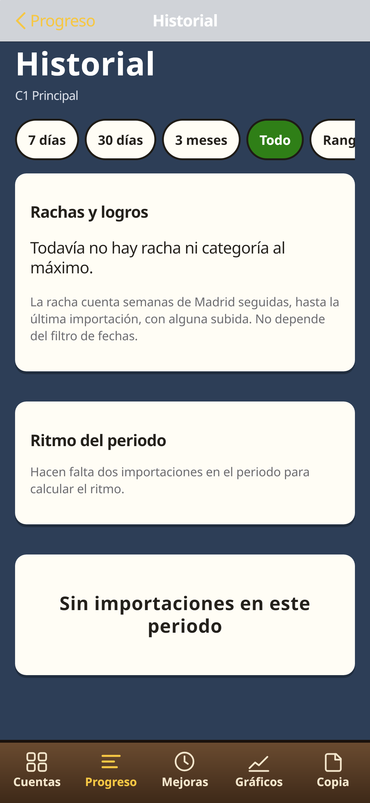 | 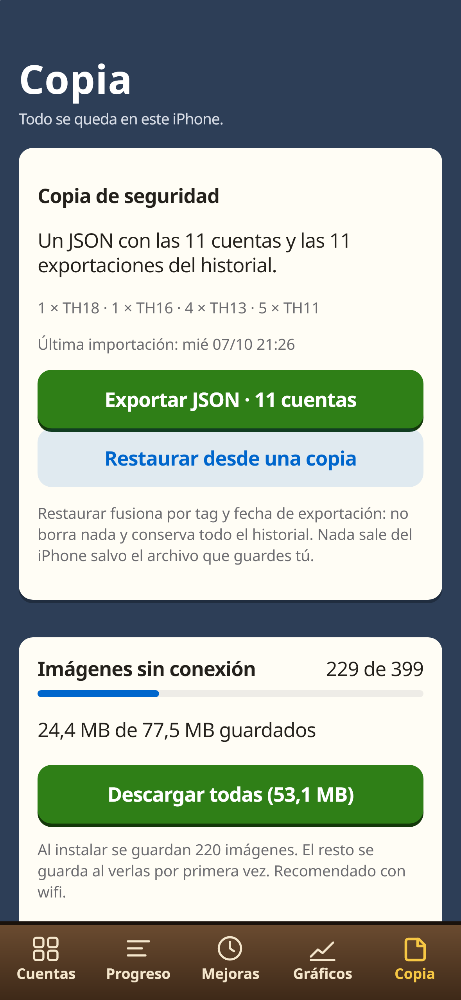 |

## Funciones

### Cuentas

- Lista de las aldeas de prueba y de las que se importen después. Se pueden marcar como Principal y ordenar.
- **Pegar exportación**: un botón lee el portapapeles, detecta una o varias aldeas y añade o actualiza por tag. Si Safari no deja leer el portapapeles, se abre el campo de pegado de siempre. También se pueden elegir archivos `.json`.
- Grupos opcionales (hasta 6, de 16 caracteres: principal, farming, TH11) para filtrar en Cuentas, Gráficos y Ranking.
- Resumen de la flota: media, constructores ocupados y libres, laboratorios y casas de mascotas libres, y la próxima mejora con hora.
- Accesos a Qué hacer ahora, Ranking y Agenda.

### Progreso y filtros

- Porcentajes por categoría con la misma regla de la 2.x: el máximo lo deciden los topes, no el estado del nombre.
- Filtros de periodo (7 días, 30 días, 3 meses, todo o un rango), recurso (oro, elixir, oscuro, otros), ayuntamiento y grupo. Valen en Progreso y en Gráficos.
- Coste y tiempo hasta el máximo del ayuntamiento actual: oro, elixir, oscuro, otros recursos y días de constructor. La fuente es `data/costes.json` (clash-of-clans-data 0.18.0, solo aldea principal). Un muro de «oro o elixir» se paga con uno de los dos, no con los dos. No entra el coste de subir el ayuntamiento.

### Gráficos

Todas las cuentas visibles van en el mismo gráfico, con un color fijo y una leyenda legible en el iPhone:

- Líneas superpuestas del porcentaje medio.
- Barras agrupadas por categoría.
- Barras apiladas (cada color es el % de una categoría, no una suma de recursos).
- Mapa de calor de cuentas × categorías.
- Radar y ritmo semanal, de una cuenta.

Cada punto es una exportación real. Con un solo día importado, la línea es un punto.

### Plan y agenda

- Plan por cuenta: laboratorio, edificios de ejército, héroes, defensas, trampas, recursos, muros, mascotas y equipamiento. Dentro de cada grupo va primero lo más atrasado. Se proponen tantas obras como constructores libres.
- Los héroes de `#28PLGP0G2` no entran en el plan.
- Cada constructor, el laboratorio y la casa de mascotas tienen una línea: qué se está mejorando, a qué hora de Madrid queda libre y qué toca después.
- Horas de sueño opcionales, guardadas en el iPhone. La mejora en curso no se mueve. La siguiente no empieza ni acaba dentro de ese tramo.
- Si la exportación no trae los segundos que faltan, se avisa. No se inventa la hora.
- La agenda junta esas horas de todas las cuentas: qué queda libre cada día y a qué hora.

### Historial, ranking y avisos

- Historial de lo que subió entre importaciones, ritmo en niveles por semana de Madrid, y rachas (semanas seguidas mejorando, categoría al máximo, ayuntamiento completado).
- Ranking y comparación de dos o tres cuentas.
- Aviso cuando termina una mejora, solo con la app abierta en un iPhone con la PWA instalada (iOS 16.4 o posterior, si el sistema deja usar notificaciones). Con la app cerrada no hay aviso: eso exigiría un servidor, y esta app no tiene.

### Copia

- JSON con las cuentas y el historial. Al restaurar se fusiona por tag y por fecha de exportación: no borra lo que solo está en el iPhone.
- Descarga de imágenes para usarlas sin conexión.
- Restaurar los datos de prueba o borrar todos los datos, con confirmación.

## Instalarla en el iPhone

1. Abre [https://ardu01.github.io/clash-progreso/](https://ardu01.github.io/clash-progreso/) en **Safari**.
2. Toca **Compartir**.
3. Toca **Añadir a pantalla de inicio** y confirma.
4. A partir de ahí, ábrela desde el icono.

Safari y la app de la pantalla de inicio no comparten datos. Lo que importes en una pestaña de Safari no aparece en la app instalada: impórtalo desde el icono.

La primera visita con red guarda la interfaz. Las imágenes se pueden descargar desde Copia para abrirlas sin conexión.

## Exportar la aldea y pegarla

En el juego, el camino que muestra la app es:

**Ajustes → Más ajustes → Exportar datos → Copiar.**

El juego copia un JSON al portapapeles. No crea un archivo y no incluye el nombre del jugador. En Clash Progreso, en Cuentas, toca **Pegar exportación**.

El menú en inglés, comprobado, es *Settings → More Settings → Data Export → Copy*. Los nombres en español de esos menús siguen sin confirmar; la app usa los de arriba hasta poder comprobarlos en el cliente.

Si el botón no puede leer el portapapeles, se abre Importar: mantén pulsado el campo y elige Pegar, o elige uno o varios `.json` en Archivos.

## Privacidad

Las cuentas, el historial, los grupos, los filtros y las horas de sueño se quedan en este navegador (`IndexedDB` y `localStorage`). No hay cuenta, no hay login y no se envía nada a un servidor. Lo único que sale del iPhone es el archivo de copia si lo guardas tú (Archivos, AirDrop u otra app del sistema).

Actualizar la app no borra las cuentas ni el historial. El roster sigue en la versión 2: una cuenta borrada no vuelve a sembrarse. Las imágenes no cambian respecto a la 2.1.4 y siguen en la caché `cp-img-v5`.

## Historial de versiones

| Versión | Qué cambió |
| --- | --- |
| 3.0.0 | Varias cuentas en los mismos gráficos, pegado directo, flota, filtros, plan con agenda, coste hasta el máximo, ranking, historial con rachas y avisos con la app abierta. |
| 2.1.4 | Encuadre de los iconos en Safari (el dibujo al 85 %) e identificación de niveles y piezas. |
| 2.1.3 | Iconos con margen. La interfaz deja de mostrar «ID deducido». |
| 2.1.2 | Cada miniatura muestra el PNG entero, sin recorte. |
| 2.1.1 | Miniaturas al tope de una pantalla @3x. El aviso legal queda solo en Copia. |
| 2.1.0 | Imagen oficial del nivel de cada edificio. |
| 2.0.0 | Cuentas propias, cinco pestañas y copia que fusiona sin borrar. |
| 1.1.6 | Icono de la PWA. |
| 1.1.5 | Descarga parcial, alertas accesibles y etiquetas de equipamiento. |
| 1.1.4 | Auditoría de diseño, foco en las hojas y manifiesto v1.4.1. |
| 1.1.3 | Ajustes de Importar y manifiesto v1.3.2. |
| 1.1.2 | Logger, recuento de «sin identificar» y ajustes de Importar. |
| 1.1.1 | Importar rediseñado y contador de imágenes. |
| 1.1.0 | Imágenes v1.2 y máximo en cada fila. |
| 1.0 | Primera PWA, con las 11 cuentas de prueba. |

El detalle de cálculos e interfaz está en `docs/sistema.md`.

## Aviso

This material is unofficial and is not endorsed by Supercell. For more information see Supercell's Fan Content Policy: [www.supercell.com/fan-content-policy](https://www.supercell.com/fan-content-policy).

Material no oficial, no respaldado por Supercell. Las imágenes son del Supercell Fan Kit y se muestran sin modificar. Esta app es gratuita, privada y sin fines comerciales.

[Leer la Fan Content Policy](https://supercell.com/en/fan-content-policy/)
