

  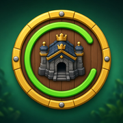

<h1 align="center">Clash Progreso</h1>

  <strong>Versión 3.1.7</strong> 
  Seguimiento de varias cuentas de Clash of Clans, en el iPhone y sin servidor. 
  <a href="https://ardu01.github.io/clash-progreso/">Abrir la app</a>

Clash Progreso guarda las exportaciones que cada persona pega, calcula el avance hacia el máximo del ayuntamiento y lo compara entre cuentas. No hay login ni backend. Las 11 aldeas incluidas son datos de prueba: se pueden añadir, renombrar y borrar.

## Capturas

iPhone (393×852, escala 3), con las exportaciones del 7 de octubre de 2026.

| Cuentas | Qué hacer ahora | Plan |
| --- | --- | --- |
| 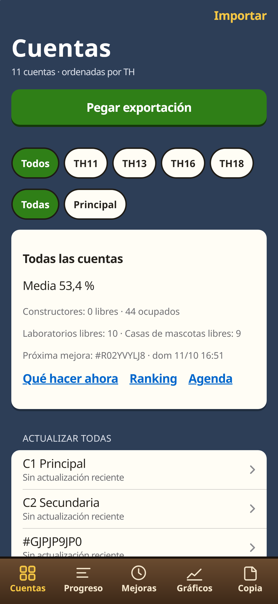 | 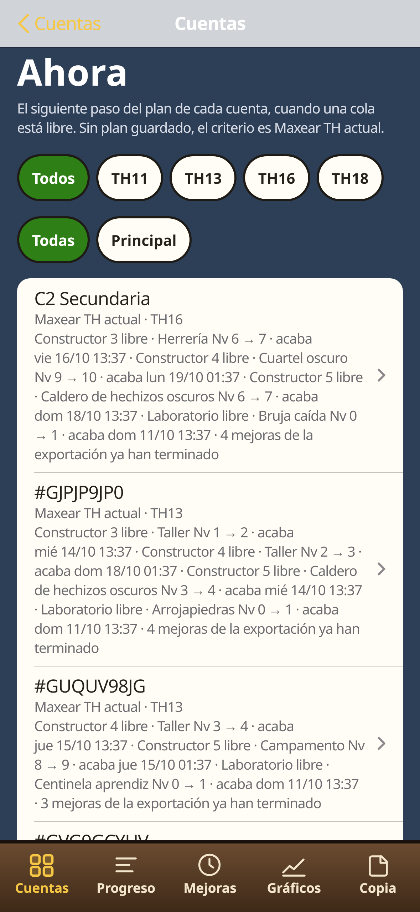 | 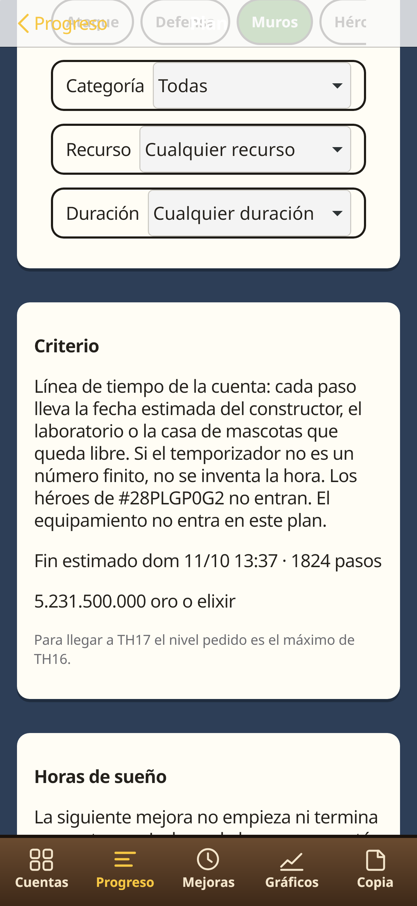 |

| Progreso | Equipamiento | Niveles |
| --- | --- | --- |
| 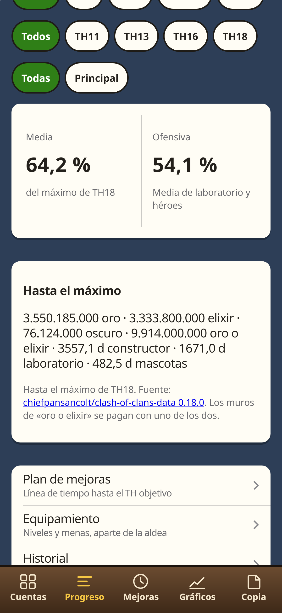 | 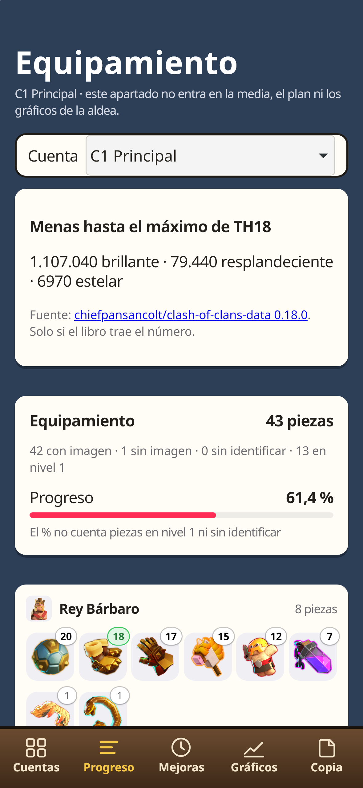 | 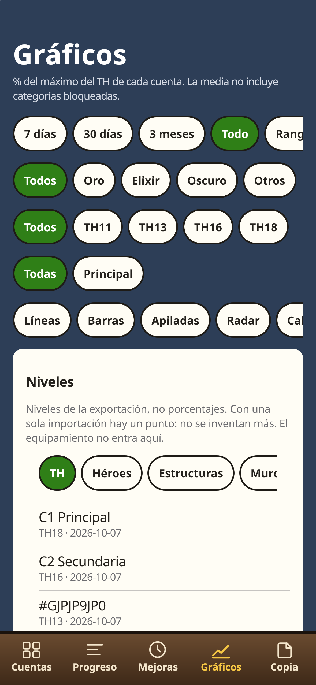 |

| Copia | Oscuro |
| --- | --- |
| 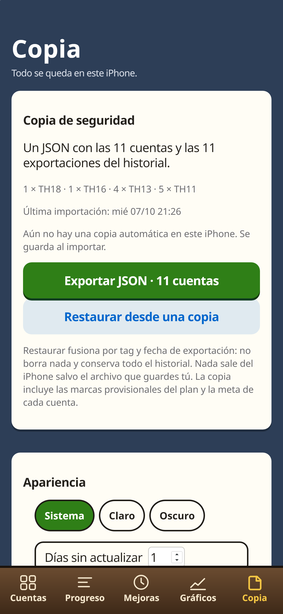 | 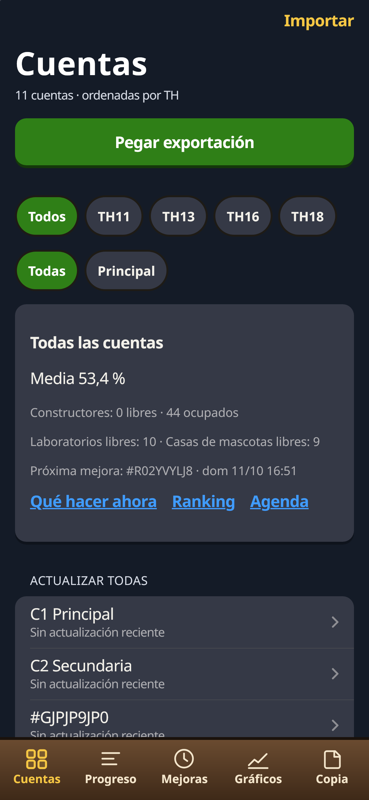 |

3.1.2, iPhone de 375 px de ancho, en claro y en oscuro.

| Inicio | Cuentas | Análisis |
| --- | --- | --- |
| 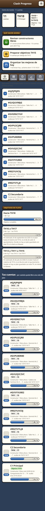 | 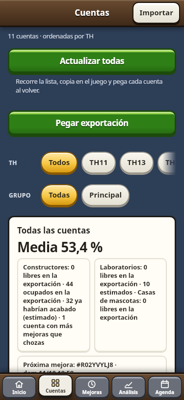 | 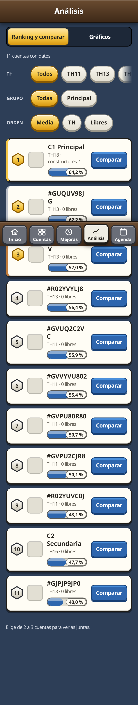 |

| Mejoras | Calor | Plan |
| --- | --- | --- |
|  | 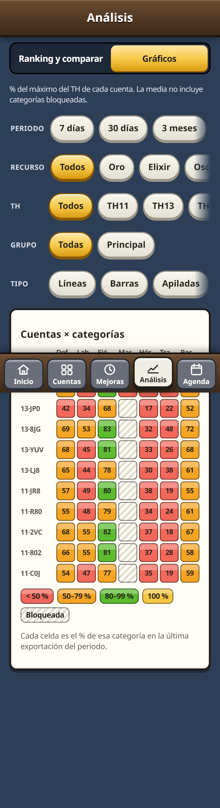 |  |

| Inicio oscuro | Cuentas oscuro |
| --- | --- |
| 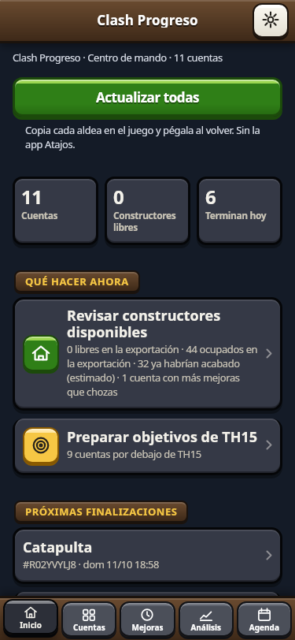 | 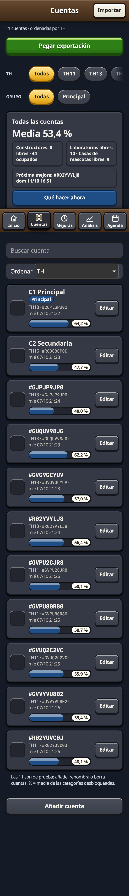 |

## Funciones

La barra de abajo tiene cinco pestañas: **Inicio**, **Cuentas**, **Mejoras**, **Análisis** y **Agenda**. Copia y Acerca de, con el aviso de la Fan Content Policy, se abren con el botón de ajustes de Inicio.

### Inicio

- Resumen: número de cuentas, TH de la principal y el objetivo del roster (por ejemplo TH18 + TH17 + 9×TH15), con cuántas cuentas ya lo han alcanzado.
- Qué hacer ahora: constructores libres, el objetivo que más cuentas tienen por debajo y las mejoras que acaban hoy.
- **Abrir hoy**: en qué orden abrir las cuentas, según el plan y la hora en que queda libre un constructor, el laboratorio o la casa de mascotas. Si el temporizador no es un número, esa cuenta no entra en el orden y no se inventa la hora.
- **Objetivos de flota**: las cuentas que comparten objetivo (por ejemplo todas las TH13 y las TH11 hacia TH15), cuántas ya están y la fecha estimada. Esa fecha es el fin del plan hasta el máximo del TH anterior, no el día de subir el ayuntamiento. Si la cuenta no tiene un plan guardado con ese TH, el criterio es Maxear.
- Tus cuentas, con la miniatura del ayuntamiento, ordenadas por esa misma prioridad.

### Cuentas

- Lista de las aldeas de prueba y de las que se importen después. Se pueden marcar como Principal y ordenar.
- **Pegar exportación**: un botón lee el portapapeles, detecta una o varias aldeas por el tag y añade o actualiza. Si Safari no deja leer el portapapeles, se abre el campo de pegado de siempre. También se pueden elegir archivos `.json`, o abrir la app con varias aldeas juntas (`docs/atajo.md`).
- Búsqueda por el alias de la cuenta.
- Grupos opcionales (hasta 6, de 16 caracteres: principal, farming, TH11) para filtrar en Cuentas, Gráficos y Ranking.
- Meta opcional de una categoría o de la media, con una barra de progreso.
- Resumen de la flota: media, constructores ocupados y libres, laboratorios y casas de mascotas libres, y la próxima mejora con hora.
- Lista de cuentas sin actualización reciente. El plazo se cambia en Copia; el valor inicial es más de 7 días.
- El equipamiento de cada cuenta va en una sección propia, debajo de las categorías de la aldea, y abre el apartado de piezas y menas.

### Progreso y filtros

- Porcentajes por categoría con la misma regla de la 2.x: el máximo lo deciden los topes, no el estado del nombre. La media es la media de las categorías de la aldea. El equipamiento va en su propio apartado y no entra en esa media.
- Filtros de periodo (7 días, 30 días, 3 meses, todo o un rango), recurso (oro, elixir, oscuro, otros), ayuntamiento y grupo. Valen en Progreso y en Gráficos.
- Coste y tiempo hasta el máximo del ayuntamiento actual: oro, elixir, oscuro, otros recursos y días de constructor. La fuente es `data/costes.json` (clash-of-clans-data 0.18.0, solo aldea principal). Un muro de «oro o elixir» se paga con uno de los dos, no con los dos. No entra el coste de subir el ayuntamiento ni el de las menas.

### Gráficos

Todas las cuentas visibles van en el mismo gráfico, con un color fijo y una leyenda legible en el iPhone:

- Líneas superpuestas del porcentaje medio.
- Barras agrupadas por categoría.
- Barras apiladas (cada color es el % de una categoría, no una suma de recursos).
- Mapa de calor de cuentas × categorías, con escala de menos de 50 %, 50–79 %, 80–99 % y 100 %.
- Radar y ritmo semanal, de una cuenta.
- Niveles: evolución del TH, héroes frente a su máximo, media de niveles por categoría, distribución de muros, laboratorio, mascotas, cara a cara, cuentas del mismo TH y niveles por semana.

Cada punto es una exportación real. Con un solo día importado, la línea es un punto y el ritmo no muestra un 0 inventado. El equipamiento no entra en estos gráficos.

### Plan, ahora y agenda

- El plan es la línea de tiempo de la cuenta, también cuando no queda ningún constructor libre. Se elige Maxear o Rushear y el TH objetivo (el actual o uno superior). Se pueden combinar prioridad de ataque, de defensa, muros, héroes, categoría, recurso y duración. El criterio se lee en viñetas.
- Para un TH objetivo superior, el nivel pedido es el máximo del TH anterior. Rushear ordena almacenes, edificios de ejército y laboratorio hasta los máximos publicados. No hay una lista oficial de requisitos de ayuntamiento en los datos, y la pantalla lo dice.
- Cada paso lleva coste, tiempo y fecha estimada de Madrid, con los constructores de esa cuenta. En la línea se marcan las mejoras que se están haciendo o se van a hacer. La línea se recalcula al momento. Esas marcas no cambian niveles ni porcentajes.
- **Qué hacer ahora** enseña, en cada cuenta, el siguiente paso de esa línea cuando un constructor, el laboratorio o la casa de mascotas están libres. Si la cuenta no tiene plan guardado, el criterio es Maxear TH actual.
- Los héroes de `#28PLGP0G2` no entran en el plan.
- El equipamiento no entra en el plan. Tiene su apartado: niveles por héroe frente al máximo, menas (brillante, reluciente y estrellada) y el total de la flota.
- Horas de sueño opcionales, guardadas en el iPhone. La mejora en curso no se mueve. La siguiente no empieza ni acaba dentro de ese tramo.
- Si la exportación no trae los segundos que faltan, se avisa. No se inventa la hora.
- La agenda junta las horas reales de la exportación. Las marcas del plan no entran en la agenda ni en los avisos.

### Historial, ranking y avisos

- Historial de lo que subió entre importaciones, ritmo en niveles por semana de Madrid, y rachas (semanas seguidas mejorando, categoría al máximo, ayuntamiento completado).
- Ranking y comparación de dos o tres cuentas.
- Aviso cuando termina una mejora, solo con la app abierta en un iPhone con la PWA instalada (iOS 16.4 o posterior, si el sistema deja usar notificaciones). Con la app cerrada no hay aviso: eso exigiría un servidor, y esta app no tiene.

### Copia

- JSON con las cuentas, el historial, los planes, las marcas provisionales y la meta de cada cuenta. Al importar se guarda sola una copia en este iPhone. Si pasan 7 días sin otra, Copia lo avisa.
- Al restaurar se fusiona por tag y por fecha de exportación: no borra lo que solo está en el iPhone, ni un plan o una marca que la copia no traiga.
- Tema del sistema, claro u oscuro.
- Descarga de imágenes para usarlas sin conexión.
- Restaurar los datos de prueba o borrar todos los datos, con confirmación.

## Instalarla en el iPhone

1. Abre [https://ardu01.github.io/clash-progreso/](https://ardu01.github.io/clash-progreso/) en **Safari**.
2. Toca **Compartir**.
3. Toca **Añadir a pantalla de inicio** y confirma.
4. A partir de ahí, ábrela desde el icono.

Safari y la app de la pantalla de inicio no comparten datos. Lo que importes en una pestaña de Safari no aparece en la app instalada: impórtalo desde el icono.

La primera visita con red guarda la interfaz. Las imágenes se pueden descargar desde Copia para abrirlas sin conexión.

## Exportar la aldea y pegarla

En el juego, el camino que muestra la app es:

**Ajustes → Más ajustes → Exportar datos → Copiar.**

El juego copia un JSON al portapapeles. No crea un archivo y no incluye el nombre del jugador. En Clash Progreso, en Cuentas, toca **Pegar exportación**.

El menú en inglés, comprobado, es *Settings → More Settings → Data Export → Copy*. Los nombres en español de esos menús siguen sin confirmar; la app usa los de arriba hasta poder comprobarlos en el cliente.

Si el botón no puede leer el portapapeles, se abre Importar: mantén pulsado el campo y elige Pegar, o elige uno o varios `.json` en Archivos.

Para traer varias aldeas seguidas desde el juego, el atajo está en `docs/atajo.md`.

## Privacidad

Las cuentas, el historial, los grupos, las metas, los planes, las marcas provisionales, los filtros, el tema y las horas de sueño se quedan en este navegador (`IndexedDB` y `localStorage`). No hay cuenta, no hay login y no se envía nada a un servidor. Lo único que sale del iPhone es el archivo de copia si lo guardas tú (Archivos, AirDrop u otra app del sistema).

Actualizar la app no borra las cuentas ni el historial. El roster sigue en la versión 2: una cuenta borrada no vuelve a sembrarse. La caché de la interfaz es `cp-shell-v25` y la de imágenes `cp-img-v9`.

## Historial de versiones

| Versión | Qué cambió |
| --- | --- |
| 3.1.7 | Imágenes no oficiales, marcadas como tales, solo donde el Fan Kit no tiene ese nivel: 25 PNG nuevos (lado largo como máximo 512). La herrería 10 sigue con la oficial del 9 y la bomba aérea 12 con la oficial del 11. El Crafting Station se llama Defensa artesanal. No entra la base del constructor. |
| 3.1.6 | Perfil de cada cuenta, desde Cuentas: nombre de la cuenta, etiqueta, ayuntamiento y los ajustes que trae la exportación (constructores y ayudantes). Los héroes se ven con el nivel y el máximo de ese TH. Lo que el JSON no trae no se muestra y no se rellena a mano. |
| 3.1.5 | En Equipamiento, por cuenta y en el total de la flota: mena brillante, reluciente y estrellada para maxearlo todo, con filtros y el coste de cada nivel pendiente. Usa las tablas ya corregidas de Flecha monolítica y Colmillos eléctricos. |
| 3.1.4 | Imagen oficial de 14 niveles que estaban prestados y de la torre de supermagos. Nombres del texto del juego: Escolta títere, Orbe oscuro, Copo de escarcha, Pistola aturdidora, Cabaña de B.O.B. y Cohetes de defensa. L.A.S.S.I. lleva el punto. |
| 3.1.3 | Flecha monolítica y Colmillos eléctricos con la tabla de mena de cada uno. Bomba aérea de TH18: 8. Coste y tiempo de los niveles bajos que estaban copiados de la supercarga, y tres valores desactualizados. Diez topes de equipamiento fuera del TH en que se desbloquean. Ninguna de las 11 cuentas cambia de porcentaje. |
| 3.1.2 | Inicio con el resumen, qué hacer ahora, el orden para abrir las cuentas hoy y los objetivos de flota. Cinco pestañas: Inicio, Cuentas, Mejoras, Análisis y Agenda. Ranking en hexágono, mapa de calor por escala y el criterio del plan en viñetas. |
| 3.1.1 | Imagen oficial de 189 niveles que estaban prestados, más el Cuervo avaricioso. Catapulta, Caseta de animales, Torre Tesla y Arrojatroncos. La Artillería infernal se ve en español y sigue sin ID. |
| 3.1.0 | Qué hacer ahora sale del plan de cada cuenta. Línea de tiempo con TH objetivo y marcas. Equipamiento aparte de la media. Niveles, meta, tema oscuro, búsqueda, copia automática y atajo para varias aldeas. |
| 3.0.0 | Varias cuentas en los mismos gráficos, pegado directo, flota, filtros, plan con agenda, coste hasta el máximo, ranking, historial con rachas y avisos con la app abierta. |
| 2.1.4 | Encuadre de los iconos en Safari (el dibujo al 85 %) e identificación de niveles y piezas. |
| 2.1.3 | Iconos con margen. La interfaz deja de mostrar «ID deducido». |
| 2.1.2 | Cada miniatura muestra el PNG entero, sin recorte. |
| 2.1.1 | Miniaturas al tope de una pantalla @3x. El aviso legal queda solo en Copia. |
| 2.1.0 | Imagen oficial del nivel de cada edificio. |
| 2.0.0 | Cuentas propias, cinco pestañas y copia que fusiona sin borrar. |
| 1.1.6 | Icono de la PWA. |
| 1.1.5 | Descarga parcial, alertas accesibles y etiquetas de equipamiento. |
| 1.1.4 | Auditoría de diseño, foco en las hojas y manifiesto v1.4.1. |
| 1.1.3 | Ajustes de Importar y manifiesto v1.3.2. |
| 1.1.2 | Logger, recuento de «sin identificar» y ajustes de Importar. |
| 1.1.1 | Importar rediseñado y contador de imágenes. |
| 1.1.0 | Imágenes v1.2 y máximo en cada fila. |
| 1.0 | Primera PWA, con las 11 cuentas de prueba. |

El detalle de cálculos e interfaz está en `docs/sistema.md`.

## Aviso

This material is unofficial and is not endorsed by Supercell. For more information see Supercell's Fan Content Policy: [www.supercell.com/fan-content-policy](https://www.supercell.com/fan-content-policy).

Material no oficial, no respaldado por Supercell. Arte © Supercell bajo la Fan Content Policy. Las imágenes del Fan Kit se muestran sin modificar. Las no oficiales son una reducción (lado largo como máximo 512 px, sin recorte); imágenes no oficiales: ClashKing y Fandom (autores en el manifiesto). Esta app es gratuita, privada y sin fines comerciales.

[Leer la Fan Content Policy](https://supercell.com/en/fan-content-policy/)
